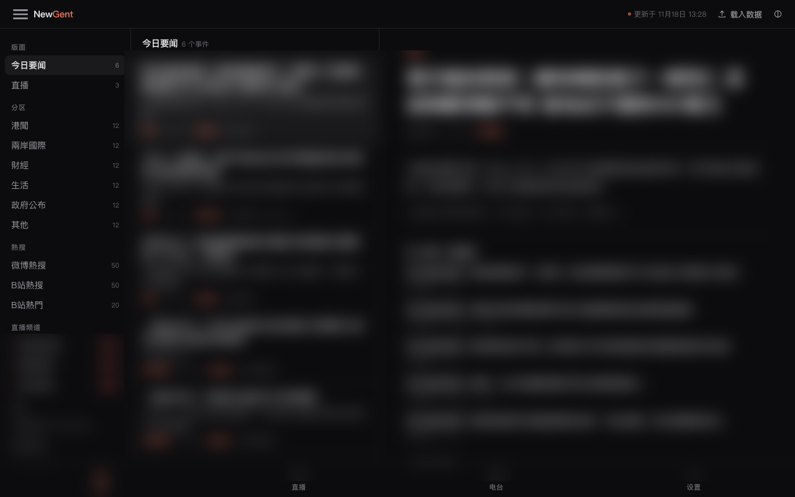
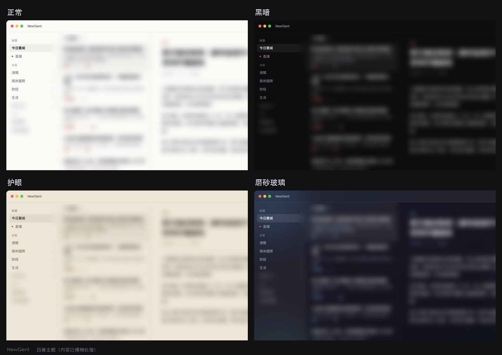

<h1 align="center">NewGent</h1>

个人新闻聚合阅读实验：把散落在各处、反复报道的时事，收进一个安静的阅读器。

  
  
  

> 本仓库仅用于产品展示，**不包含源代码**，也不提供数据源与安装包下载。
>
> **内容声明**：新闻内容版权归原媒体所有。本项目仅做个人阅读用途的聚合与索引，不存储、不再分发原文；页面中的「原文」始终指向来源站点。

---

## 是什么

NewGent 是一个自用的新闻聚合阅读器。它把同一事件在不同时间、不同媒体的报道合并成一个「事件」，给你一条时间线，而不是一堆重复的标题。

主端是网页版：数据内联在一个 HTML 文件里，双击就能读，不需要服务器；也有一个 Android 客户端用于手机侧载。两端共用同一套排版与主题。

## 功能

- **事件聚类**：同一事件的多篇报道合并成一条，右侧列出各家报道与时间，不再被重复标题刷屏。
- **一句话摘要**：每条事件除了标题，还有一行不超过 42 字的摘要，扫一眼就知道发生了什么。采用抽取式压缩，不依赖大模型。
- **分区浏览**：今日要闻、港闻、两岸国际、财经、生活、政府公布、其他等版面，侧栏一眼看到各分区条数。
- **速览视图**：要点、多源对照、今日速览三种读法。
- **热搜榜单**：聚合多个平台的热榜，作为独立视图。
- **多源覆盖**：同一事件的多方报道跨源合并，不重复推送。
- **推送摘要**：按主题分类，每类给前五热度话题，每条配一句话通俗概括，不用点开也知道发生了什么。
- **直播与电台**：底部四个模块「新闻 / 直播 / 电台 / 设置」，可直接跳到直播频道，或收听电台音频流。
- **四套主题**：正常（暖白纸感）、黑暗、护眼（米黄纸）、磨砂玻璃；偏好本地持久化。
- **键盘操作**：`↑` `↓` 切换事件，`←` / `Esc` 从详情退回列表。
- **自动刷新**：打开即显示最新内容，停留时每 60 秒自动更新；切回标签页或从后台恢复会立刻补一次，且不会顶掉你正在看的那条。
- **单文件网页版**：数据内联，离线可读；数据超过 6 小时未更新时顶栏会标红提醒。
- **Android 客户端**：Kotlin + Jetpack Compose，启动即刷新，侧载安装。

## 界面

> 截图已做模糊处理，仅展示三栏布局（侧栏 / 事件列表 / 详情）与主题样式，不展示具体新闻内容。

> 四套主题：正常 / 黑暗 / 护眼 / 磨砂玻璃。同一套排版，只换色彩与材质；内容同样已模糊处理。

## 端与状态

| 端 | 技术栈 | 状态 |
|---|---|---|
| 网页版 | 单文件 HTML + 原生 JS | 主端，日常使用 |
| Android | Kotlin + Jetpack Compose | 0.3.1，侧载使用 |
| macOS 原生 | SwiftUI | 已搁置，不做 |

## 技术要点

- 分层清晰：内容接入、去重归并、渲染三层解耦，便于维护。
- 入库前做去重与事件归并，摘要为抽取式（清套话 → 取导语首句 → 按原标点截断），不调用大模型。
- 网页版由构建脚本把数据内联进单个 HTML，零依赖、零服务端。
- 全流程本地运行，数据存本机，不上传。

## 下载与试用

暂不提供公开下载。仅作产品展示与记录。

## 许可

专有软件，**源码不公开**。本仓库中的文字与图片仅用于产品介绍，未经许可不得复制、修改或再分发。详见 [LICENSE](LICENSE)。

## 反馈

- GitHub Issues
- 作者：[@baikaylyn](https://github.com/baikaylyn)
